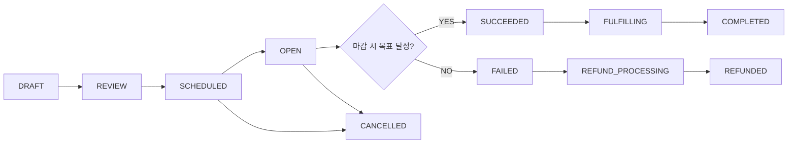
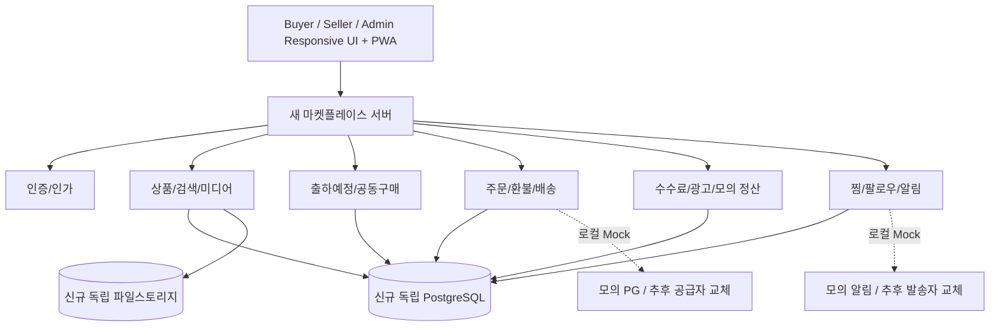

# 탄생(TANSAENG) 산지 직거래·공동구매 플랫폼 — Claude Code CLI 통합 개발 명세서

> **문서 버전:** 1.0 / **작성 기준:** 2026-10-15  
> **프로젝트 유형:** 신규 독립 프로젝트 · 반응형 Web + PWA · 로컬 우선 개발  
> **서비스명:** 탄생 (TANSAENG)  
> **대상 독자:** Claude Code CLI, 프로젝트 개발자, 제품 책임자, QA  
> **중요:** 이 문서는 구현 지시서이자 요구사항 명세서다. 아직 존재하지 않는 코드나 현재 서버 구조를 이미 확인한 것처럼 가정하지 말 것.

---

# 0. 🔴 최상위 절대 규칙 — 환경제어시스템과 기존 운영 서비스 보호

이 절은 전체 문서보다 우선한다. 기능 구현, 속도, 편의성, 코드 재사용, 테스트, 배포보다도 우선한다.

## 0.1 절대 금지 대상

**현재 가동 중인 스마트팜 환경제어시스템에는 어떠한 변경도 하지 않는다.** 기존 시스템은 온실 장비·센서·밸브·펌프·팬·창개폐 등 실제 설비와 연결되어 있을 수 있다. 코드나 설정을 단 한 줄이라도 실수로 바꾸면 실물 설비에 영향을 줄 수 있다.

- ESP32/ESP32-S3 펌웨어, 스케치, 라이브러리, 업로드 설정 및 연결된 장치를 수정·재부팅·업로드·플래시하지 않는다.
- MQTT 브로커(예: HiveMQ), 토픽, 계정, 인증서, 연결 설정, 메시지 발행/구독을 건드리지 않는다. 실제 장비 제어 토픽에는 **시험용 메시지도 절대 발행하지 않는다**.
- Node-RED 플로우·대시보드, React 기반 환경제어 UI, RS485/Modbus, W5500, 릴레이, SSR, GPIO, 센서, 창개폐, 유량·수위 로직, Watchdog 또는 안전정지 기능을 변경하지 않는다.
- 온실과 연결된 서버·프로세스·포트·서비스·DB·컨테이너·볼륨·네트워크·방화벽·라우터·스케줄러·인증정보·자동실행 항목을 변경하지 않는다.
- 기존 코드 및 설정 파일 이름 바꾸기, 이동, 복제 후 덮어쓰기, 삭제, 라이브러리/패키지 일괄 업그레이드, 포맷 변경도 하지 않는다.
- `docker system prune`, 전체 컨테이너 중지, 포트 강제 종료, 시스템 전체 서비스 재시작, 기존 프로세스 강제 종료 등의 광범위한 명령은 금지한다.
- 환경제어 시스템의 데이터/로그를 신규 마켓플레이스에 연결하거나 조회하도록 구현하지 않는다. **아키텍처, 런타임, 데이터, 네트워크, 저장소를 완전히 분리**한다.
- `www.tansaeng.com`의 기존 운영 코드, DB, 상품, 회원, AI 식물분석, 주문, 결제, 도메인, DNS, 호스팅, 인증서 및 배포 구성도 **현재 단계에서 변경하지 않는다**.
- Claude Code의 자동 편집·리팩터링·검색·테스트 범위를 보호 대상 디렉터리까지 확장하지 않는다.

## 0.2 허용된 작업 경계

1. **신규 마켓플레이스 전용의 빈 로컬 폴더**에서만 작업한다. 예시: `C:\dev\tansaeng-marketplace`. 이 경로는 예시이며 실제 경로는 사용자가 선택한다.
2. 이미 존재하는 프로젝트 루트나 기존 스마트팜/기존 홈페이지 소스 폴더 안에서는 시작하지 않는다. 빈 폴더가 아니라면 **삭제·덮어쓰기 없이 작업 중지 후 위치 확인**.
3. 허용된 폴더 내부에만 소스, 설정, 테스트, 임시 파일, 로컬 데이터/개발 문서를 만든다. 도구가 상위 디렉터리를 수정하려 하면 중지.
4. Git 저장소도 신규 전용 폴더 내부에서만 생성·수정한다. 상위 저장소, 다른 브랜치, 다른 리포지토리에 커밋·푸시하지 않는다.
5. 로컬 DB와 파일 스토리지를 독립 생성한다. 기존 DB의 이름, 계정, 포트, 접속문자열을 절대 재사용하지 않는다.
6. 초기에는 인터넷에서 실행되는 운영 환경에 **배포하지 않는다**. 원격 서버 접속, 도메인/DNS 변경, 실결제 연동, 실발송 알림, 공개 터널 개방도 금지한다.
7. 사용자의 **명시적 사전 승인** 없는 Git 원격 푸시, CI/CD 실행, 서버 업로드, 운영 DB 마이그레이션, 라이브 결제/메시지 발송은 하지 않는다.
8. 기존 시스템을 '분석해 참고'한다는 이유로 루트 전체를 읽거나 비밀값을 수집하지 않는다. 기존 시스템은 필요한 경우 사용자 승인 범위에서 **읽기 전용으로만 별도 확인**한다.

## 0.3 작업 전 필수 안전 확인

Claude Code는 코드 작성 전에 다음을 확인하고 결과를 출력해야 한다.

- 현재 디렉터리의 절대경로, 디렉터리 내용, Git 최상위 루트를 확인한다.
- 전용 빈/신규 폴더인지, 기존 프로젝트 및 환경제어 폴더와 별개인지 확인한다. 불분명하면 **코드·설정 수정 금지**.
- 사용할 포트를 개별 검사한다. 다른 서비스가 사용 중이면 **그 서비스를 건드리지 말고 새 포트**를 선택한다.
- 신규 앱이 연결할 DB·스토리지·인증·푸시·결제 등이 모두 **로컬/샌드박스**인지 확인한다.
- 안전 확인 결과를 `docs/SAFETY_BASELINE.md`에 남긴다. 문서에는 비밀번호·토큰 등 비밀정보를 기재하지 않는다.
- 신규 작업 중 운영 환경 또는 환경제어 연관성을 발견하면 즉시 **안전하게 중지**하고 사용자에게 원인과 가능한 독립 대안을 보고한다.

## 0.3-A 실행환경의 **실제 접근 차단** (문서 지시만으로는 부족함)

**프롬프트의 “수정 금지” 문구만으로 기술적인 접근 차단이 보장되는 것은 아니다.** Claude Code가 실행되는 계정/터미널이 기존 설비 파일·서버에 접근할 수 있으면 실수 가능성이 남는다.

- **가장 안전한 구성:** 스마트팜 운영 컴퓨터/서버와 별도의 개발 PC 또는 별도 VM(가상머신)에서 신규 프로젝트를 개발. 해당 VM에는 환경제어 소스, 운영 DB 인증정보, ESP32 장치, MQTT/Node-RED 관리 계정, 운영 SSH 키를 **넣지 않는다**.
- 동일 PC에서 작업해야 한다면 **관리자 권한 없는 개발 전용 OS 계정**, 허용 폴더만 읽기/쓰기 가능한 파일 권한, 기존 운영 폴더 접근 제한을 적용한다. 운영 제어에 필요한 계정·프로세스는 별도 계정/권한으로 보호한다.
- 외부 장비/운영망으로 향하는 접속은 방화벽 및 네트워크 구성으로 차단하는 것이 좋다. 프롬프트에만 의존하지 않는다.
- Docker가 이미 환경제어 시스템과 공용이면 **Docker 데몬/소켓 접근 자체가 다른 컨테이너 조작 권한이 될 수 있다**. 그 데몬을 공유하지 말고 개발 전용 VM/독립 런타임 또는 Docker 없이 새 전용 로컬 서비스로 개발한다.
- Claude Code 실행 시 자동승인/무제한 권한 모드는 사용하지 않는다. 명령 실행/파일 수정 승인 경계를 최소화한다. 기존 보호 경로를 포함한 광역 도구 접근은 허용하지 않는다.
- 기존 시스템 파일 목록과 운영 구성을 알아야만 할 것 같더라도 임의 탐색 금지. 안전한 별도 환경에서 독립 구현이 불가능할 때는 중지하여 이유를 보고한다.

## 0.4 완료 조건: 불변성 보장

어느 작업 단계에서도 다음이 유지되어야 한다.

- 기존 스마트팜 환경제어 코드 및 런타임 변경 0건
- 기존 `www.tansaeng.com` 코드·설정·서비스 변경 0건
- 라이브 도메인/DNS/호스팅 변경 0건
- 기존 생산 서버/브로커/DB 접근 또는 명령 실행 0건
- 실제 결제·문자·푸시 대량발송 0건 (로컬 개발 중)

> **우선순위 원칙:** 환경제어시스템 보호 > 기존 운영 홈페이지 보호 > 개인정보/결제 안전 > 데이터 무결성 > 사용자 경험 > 구현 속도.

---

# 1. 제품 개요 및 확정된 사업 방향

## 1.1 서비스 정의

**탄생**은 농·축·어업 생산자가 직접 생산한 상품을 등록하고 구매자와 거래하는 **생산자 중심 마켓플레이스**다. 당근처럼 등록은 쉽고, 쿠팡처럼 상품을 체계적으로 탐색·구매하며, 대량 출하물량은 공동구매와 출하예정 알림으로 수요를 미리 모은다.

- 전국 산지직송을 지향한다. 플랫폼은 원칙적으로 재고·물류센터를 보유하지 않는다.
- 주 수익모델: 거래 중개수수료 + 유료 광고/프로모션.
- 생산자는 농·축·어업 관련 적격자에 한정한다. 일반 개인의 중고·공산품 자유 판매는 현재 범위가 아니다.
- **사업자등록 보유 생산자**를 기본 중개판매자로 승인한다.
- **경영체등록 증빙만 있는 생산자**는 회원가입·입점 심사를 허용하되, 실제 직접 판매 자격과 세무 요건을 검증한다. 자동 판매 허용 금지.
- 필요 시 **탄생 직접판매형**(농가에서 탄생이 실제 매입해 소비자에게 재판매, 농가는 직배송 가능)을 별도 거래모델로 설계한다. 이 모델은 법무·세무·PG 승인 전 실사용 `OFF`.
- 구매자는 개인(B2C)이 중심이고, 업소·사업자 대량 구매(B2B)를 위한 견적 및 대량주문 기능은 확장 대상으로 둔다.
- 모바일 브라우저와 PC 브라우저에서 기능을 모두 제공하고 PWA 설치를 지원한다.
- **개발은 로컬 전용**으로 시작하며, 온라인 배포는 별도 승인 절차다.

## 1.2 플랫폼 차별화

1. **수확/출하 예정 물량 공개:** 1주일 전부터 예정 상품과 예상 물량, 출고일, 예정 판매가격 공개.
2. **공동구매:** 최소 주문 목표와 가격/공급량/마감시각이 명확한 그룹구매.
3. **관심상품·생산자 팔로우:** 찜·알림 등록으로 신상품, 출하 일정, 가격 변화를 놓치지 않음.
4. **빠른 농가 등록:** 사진, 품목, 가격, 수량으로 등록; 운영자 대리등록도 지원.
5. **생산 이력 및 신뢰:** 원산지, 생산자 인증, 재배/수확 이미지·영상, 배송품질 지표.
6. **판매자가 많아도 비교는 단순하게:** 같은 품목·규격을 묶어 총구매가격(배송비 포함)을 비교.
7. **대량 물량 소진:** 공동구매 외 사업자 대량구매·문의·견적을 향후 연결.

## 1.3 확정 사항 vs 검토 사항

| 구분 | 상태 | 정책 |
|---|---|---|
| 브랜드 | 확정 | 탄생 / TANSAENG |
| 웹 + PWA | 확정 | 구매자·판매자·관리자 PC/모바일 모두 지원 |
| 로컬 선개발 | 확정 | 출시 승인 전 외부 배포 없음 |
| 환경제어·기존 홈페이지 보호 | 절대 확정 | 수정·재시작·연동 금지 |
| 사업자 농축어업 생산자 입점 | 방향 확정 | 서류 및 품목별 적격성 심사 |
| 경영체만 있는 농가 | 조건부 | 가입/심사 허용, 판매 개시 전 법무·세무 검증 |
| 거래 중개수수료·광고 | 확정 | 구체 수수료율은 관리자 설정, 초기 샌드박스 임의 기본값 |
| 직접판매형 | 선택/미확정 | 계약·세무·정산·환불 설계, 출시 기본 OFF |
| PG/택배/메시지 공급자 | 미선정 | 추상 인터페이스+모의 구현, 실서비스 키 사용 금지 |
| 기존 도메인에 통합하는 방법 | 미확정 | 별도 배포 후 별도 승인으로 연결 계획 수립 |

---

# 2. 사용자 유형 및 접근 권한

| 역할 | 회원/상품 탐색 | 상품 등록·수정 | 주문·배송 | 광고 신청 | 입점·정산·신고 관리 |
|---|---|---|---|---|---|
| 비회원 | 공개 목록·상세 조회 | 불가 | 장바구니 임시만 | 불가 | 불가 |
| 구매자 | 검색·찜·팔로우·알림 | 불가 | 본인 주문·반품·후기 | 불가 | 불가 |
| 판매자(심사대기) | 구매자 권한 | 판매 게시 불가, 초안 가능 | 불가 | 불가 | 자기 심사상태 조회 |
| 판매자(승인) | 구매자 권한 | 자신의 상품/공동구매 | 자신의 주문만 | 신청/성과 조회 | 자신의 정산내역 |
| 판매자 직원(확장) | 인가된 상점 데이터 | 부여받은 하위 권한만 | 인가된 주문만 | 제한 | 제한 |
| 관리자 | 전 목록 및 운영화면 | 승인·숨김·정책 집행 | 분쟁·정산 관리 | 광고 심사 | 입점 심사·로그 |
| 최고관리자 | 위와 동일 | 위와 동일 | 위와 동일 | 위와 동일 | 운영자 권한/보안설정 |

**RBAC 강제:** 화면 감춤만으로 권한을 구현하지 않는다. 서버 API·DB 접근 전 소유자 및 역할을 검사한다. 관리자 동작은 감사로그를 기록하고 승인·반려 사유를 남긴다.

회원 상태: `PENDING`, `APPROVED`, `REJECTED`, `SUSPENDED`; 판매자 정체성 `BUSINESS_PRODUCER`, `FARM_ENTITY_ONLY`, `PLATFORM_SUPPLIER`; 판매 권한은 별도 플래그로 명시한다.

---

# 3. 정보구조(IA) 및 핵심 URL

```text
/                         구매자 홈
/categories                전체 카테고리
/category/[slug]           카테고리 상품 목록
/search                    검색/필터/정렬
/products/[slug]           상품 상세 (사진·영상·상세설명·판매자)
/group-buys                공동구매 모아보기
/group-buys/[id]           공동구매 상세/진행률/일정
/upcoming                  출하예정/오픈예정 캘린더
/farms/[slug]              인증 생산자·농장 스토어
/wishlist                  찜한 상품
/following                 팔로우한 생산자
/alerts                    관심 알림·수신설정
/cart                      장바구니
/checkout                  주문·결제(샌드박스)
/orders                    내 주문/배송/취소/반품
/orders/[id]               주문 상세
/reviews                   내가 쓴 후기/후기 작성
/account                   회원/주소/동의/보안 설정
/help                      FAQ·문의·분쟁 접수
/auth/*                    로그인·회원가입·인증
/seller                    생산자 대시보드
/seller/onboarding         판매자 서류·신원·품목 심사
/seller/products           상품 목록/재고/승인상태
/seller/products/new       쉬운 상품 등록 위저드
/seller/products/[id]/edit 수정/미리보기
/seller/group-buys         공동구매/출하예정 등록·관리
/seller/orders             주문 접수/송장/출고
/seller/settlements        매출·수수료·정산 내역
/seller/ads                광고 신청/성과
/seller/store              생산자 스토어 소개·정책
/seller/support            문의/반품/분쟁 대응
/admin                     운영 대시보드
/admin/sellers             판매자 서류 심사/정지
/admin/products            상품 검수·신고·카테고리
/admin/group-buys          공동구매 운영·승인
/admin/orders              주문/환불/이상 거래
/admin/settlements         수수료·정산·대사
/admin/ads                 광고 슬롯/심사/정산
/admin/notifications       알림 예약/발송 로그/동의
/admin/support             고객센터/분쟁/반품
/admin/content             배너·카테고리·공지·FAQ
/admin/analytics           거래액·활성회원·전환율
/admin/audit               관리자 작업이력
/admin/settings            수수료·약관·운영설정
```

단일 Next.js 앱 내 URL 분리로 시작하되 코드/권한은 분리한다. 차후 서브도메인 도입 가능. 이 URL들은 새 로컬 앱 안에서만 사용하며 기존 `www.tansaeng.com` 경로는 변경하지 않는다.

---

# 4. UI/UX 디자인 규칙 (PC + 모바일 필수)

## 4.1 제품 디자인 시스템

- 톤: 현대적인 커머스 UI + 산지 생산자의 신뢰감. 특정 작물에 종속된 캐릭터/컬러는 지양.
- 제안 색상(확정 전): 브랜드 그린 `#176B4A`, 딥그린 `#24362D`, 아이보리 `#F2F5ED`, 강조 오렌지 `#F2A541`; 텍스트 대비 WCAG AA 검증.
- 한글 중심, 금액에 천 단위 쉼표, 배송비/무게/단위/원산지 분명히 표시.
- 반응형 구간(예시): 모바일 320~767px / 태블릿 768~1023px / PC 1024px 이상. 화면 축소·가로스크롤 강요 금지.
- 소비자 모바일은 하단 메뉴: **홈 / 카테고리 / 공동구매 / 찜 / 마이**.
- 판매자 모바일은 하단 메뉴: **현황 / 상품 / 주문 / 정산 / 더보기**; PC는 왼쪽 사이드바.
- 관리자 모바일은 간결한 메뉴+검색/필터; PC는 데이터테이블, 대시보드, 작업 큐를 최적화.
- 모바일 주요 탭 영역은 손가락 터치가 용이하도록 설정; 접근성 키보드 탐색, 포커스, 폼 라벨, 오류메시지, 이미지 대체 텍스트 지원.
- 상품 스켈레톤/빈 화면/오류/로딩/재시도 및 느린 인터넷 UX까지 구현.

## 4.2 구매자 홈 화면

```text
[탄생 로고] [통합검색창] [알림] [로그인/마이]
[전체 카테고리: 농산물 | 축산물 | 수산물]
[메인 배너: 이번 주 공동구매 / 출하 예정]
[곧 오픈: D-7 ~ D-Day 카운트다운, 알림 신청]
[오늘 판매 중인 공동구매: 목표수량·현재 주문량·마감일]
[산지직송 추천 상품 / 최근 등록 상품]
[지역별·품목별 탐색]
[인증 생산자·농장 소개]
[인기 찜 / 재구매 추천 / 공지]
[푸터: 판매주체 고지·고객센터·약관·사업자 정보]
```

**메인에 허위 할인율, 허위 수요/구매자 숫자, 근거 없는 ‘오늘만’ 타이머를 표시하지 않는다.** 광고는 `광고` 표시.

## 4.3 상품 카드 표준

- 대표사진(1:1 권장), 상품명, 생산지, 중량·규격, 최종 예상 결제액(상품가+배송비), 기본 배송 조건.
- `인증 생산자`, `공동구매`, `출하예정`, `광고` 배지의 의미를 명확히 구분.
- 좋아요(찜) 아이콘, 상세 열기, 판매자 스토어 링크, 재고/판매 상태.
- 동일 품목의 크기·등급·무게·배송지역이 다르면 무조건 ‘동일상품 최저가’로 비교하지 않는다.
- 검색 결과는 무료 기본 노출 + 품질·가격·최근성·주문이행을 활용. 유료 스폰서 상품은 구분해서 표기.

## 4.4 상품 상세 화면

1. **미디어 갤러리:** 메인 사진, 서브 사진(초기 총 10장 제안), 짧은 영상(초기 1개 제안), 확대/재생/자막 또는 설명.
2. **구매 패널:** 상품명, 실판매자, 생산자 인증, 출하 지역, 원산지, 규격, 가격, 옵션, 수량, 재고/공동구매 상태.
3. **배송 정보:** 출고예정일, 예상 배송 안내, 택배사(등록 시), 배송비, 제주·도서산간 비용, 신선식품 특성.
4. **행동:** 찜, 공유, 생산자 팔로우, 알림 신청, 장바구니, 구매하기.
5. **상세 내용:** 생산자 소개, 수확·재배 사진·영상, 상품 구성·등급·보관법·포장 방식.
6. **구조화 정보:** 원산지, 생산자/판매자, 실 판매주체가 탄생인지 생산자인지, 고지사항, 반품 정책.
7. **리뷰/문의:** 실제 구매자 후기, 사진 후기, 판매자 답변, 신고 기능.
8. **연관 상품:** 같은 품목 비교, 같은 생산자의 다른 상품, 다음 출하예정.
9. **모바일 고정 구매바:** 금액·옵션·주문 버튼만 간결하게.

## 4.5 판매자 상품등록 위저드

```text
STEP 1 판매 유형 : 일반판매 / 출하예정 / 공동구매
STEP 2 기본정보 : 카테고리 > 품목 > 상품명 > 원산지·생산지
STEP 3 미디어    : 사진 1~10, 영상 0~1, 대표사진 선정, 순서변경
STEP 4 판매조건 : 규격·중량·옵션·가격·재고·출고일·배송비
STEP 5 상세설명 : 간편 템플릿 / 직접 편집 / AI 초안(후속)
STEP 6 검토      : 판매자 표시, 환불·교환 정보, 개인정보/광고 규정 확인
STEP 7 등록      : 미리보기 > 임시저장 > 검수/게시
```

- 등록 중 자동 임시저장, 이어서 작성, 오류 시 필드별 안내.
- 촬영 사진의 EXIF 위치정보를 제거하고 이미지 회전 보정·리사이즈·웹 최적화.
- 상품마다 재고 단위(kg, g, 박스, 망, 개 등), 최소주문수량, 단계가격(확장)을 지원할 수 있는 데이터 구조.
- **인터넷 사용이 어려운 농가**를 위해 운영자의 ‘판매자 대신 등록’ 기능 제공. 위임 동의, 작성자 및 승인자 로그 필수.
- 관리자 검수 대상 품목은 게시 전 승인; 법적 표시사항 미입력 시 게시 방지.

## 4.6 관리자 운영 UI

- 대시보드: 판매자 심사대기, 신규 상품 검수, 오늘 주문, 배송 지연, 반품·분쟁, 공동구매 일정, 광고 심사, 정산 이슈.
- 각 업무는 리스트→필터→상세→승인/반려/보류→이력 기록 흐름.
- PC 테이블은 필터·정렬·페이지네이션·CSV 다운로드(개인정보 최소화) 제공.
- 모바일에서 핵심 승인, 메시지, 주문조회가 가능해야 하나, 대량 정산 작업은 PC에서 더욱 효율적이어야 한다.

---

# 5. 카테고리·상품규격·검색 및 비교

## 5.1 시작 카테고리

```text
농산물
 ├ 채소(양파·쪽파·대파·마늘·감자·배추 등)
 ├ 과일
 ├ 곡물·잡곡
 ├ 버섯
 └ 기타 농산물
축산물
 ├ 소고기 ├ 돼지고기 ├ 닭·오리 ├ 계란 └ 기타
수산물
 ├ 생선 ├ 조개·패류 ├ 갑각류 ├ 해조류 └ 기타
공동구매(판매형태 필터; 별도 물품 카테고리 아님)
출하예정(판매상태 필터; 별도 물품 카테고리 아님)
```

축산물·수산물의 판매는 품목/가공상태/판매방식별 인허가 검증 후 허용한다. **초기 실거래 출시 범위는 일반 원물 농산물 중심을 권장**하며, 축산·수산은 테스트 데이터 또는 승인된 판매자만 조건부 활성화.

## 5.2 검색 필터

품목/키워드, 농·축·수, 세부 카테고리, 판매지역, 원산지, 생산자, 규격/중량, 가격대, 총비용(배송비 포함), 일반/공동구매/출하예정, 출고예정일, 재고, 배송지역, 등급·인증(증빙 확인된 것만), 후기, 정렬(관련도/가격/최근/판매량).

## 5.3 동일상품 비교 로직

- `normalized_product_key`는 품목+품종+중량+등급+가공상태+포장단위로 생성(관리자 조정 가능).
- 가격 비교는 최소한 상품가+필수 배송비+필수 옵션 가격 포함 **동일 비교 기준**으로 수행.
- 상이한 배송지/중량/등급/품질을 같은 가격으로 묶어 최저가로 오인시키지 않는다.
- 동일 목록에서는 예: `가성비`, `품질/후기`, `빠른 출고`, `공동구매 특가` 추천 탭 지원.
- 판매자 입점 수는 임의로 2명 제한하지 않는다. 초기 검증 농가 수는 관리 가능 범위에서 시작. 특정 공동구매 행사 공급자는 선정할 수 있다.

---

# 6. 찜·관심상품·생산자 팔로우·알림 기능 (핵심)

## 6.1 찜 동작

- 상품 카드·상세페이지에서 `♡` 클릭 → `♥` 전환, 다시 클릭하면 해제.
- 비로그인은 로그인 안내 또는 세션 임시 찜 가능; 로그인 후 의사 확인해 병합.
- 사용자의 찜 목록은 사용자 본인에게만 노출. 관리자도 불필요한 개인별 조회 금지.
- 품절·판매종료된 상품은 찜 기록에 남기되 구매 버튼은 비활성; 대체 상품을 제안.
- 서로 다른 옵션·농가의 유사 상품을 혼동하지 않도록 상품/옵션 ID 기준 저장.
- `찜`은 **구매 예약·구매 확정·공동구매 목표 달성이 아니다**.

## 6.2 관심상품 화면 `/wishlist`

상단 탭: `전체 / 일반판매 / 공동구매 / 오픈예정 / 판매종료`; 검색 및 정렬 `최근 찜 / 가격 / 오픈순`.

카드별: 대표사진, 상품명, 판매농가, 최종 가격, 배송비, 품절/오픈 상태, 알림 상태, 삭제, 상품 보기, 장바구니. 공동구매는 남은 시간·목표수량을 별도로 표기.

기능: 다중 선택 찜 해제, 품절 상품만 보기, 비슷한 상품 추천, 찜한 생산자 바로 이동, 비어 있을 때 카테고리 탐색 유도. PC는 그리드/리스트 전환, 모바일은 2열 카드 또는 카드 리스트.

## 6.3 생산자 팔로우 `/following`

- 생산자 스토어에서 팔로우/해제.
- 팔로우 농가의 신규 상품, 출하예정, 공동구매 소식을 묶은 피드.
- 팔로우 자체가 마케팅 푸시 수신 동의는 아님. 별도 알림 종류·채널·광고성 정보 동의 체크.

## 6.4 알림 구독 데이터와 종류

| 종류 | 트리거 | 기본 처리 |
|---|---|---|
| 공동구매 시작 | 특정 상품 판매 시작 시각 | 사용자 명시 신청 및 적법한 발송 동의 확인 |
| 마감 임박 | 종료 일정 기준 | 별도 선택한 구독에 한함, 발송횟수 제한 |
| 출하예정 오픈 | 출고/판매 가능 전환 | 해당 상품 구독자 |
| 가격변경 | 찜 상품 가격 변동 | 사용자가 선택한 경우 |
| 재입고 | 품절 → 판매 가능 | 재입고 신청자 |
| 팔로우 생산자 신상품 | 상품 승인·게시 | 해당 알림 종류 신청자 |
| 주문·결제·배송·환불 | 본인 거래 상태 | 필수 거래 알림과 광고 알림을 구분 |

- 채널: 인앱 알림(1차), PWA 웹 푸시(2차), 외부 문자/카카오 발송(추후 공급자 계약 이후).
- 알림 예약은 DB에서 동의상태·타임존 `Asia/Seoul`·중복발송키·취소/품절을 검사한다.
- 사용자가 신청했던 알림도 판매 취소/일정 변경 시 알맞게 처리하고, 광고성 알림 수신거부를 존중.
- 프로모션/공동구매 안내의 광고성 여부는 정보통신망법과 발송채널 정책에 따라 법무검토 후 결정. **거래 알림과 마케팅 동의를 혼합하지 않는다.**
- 초기 로컬에서는 모의 발송 로그만 만든다. 실제 푸시·SMS·카카오 발송 금지.

---

# 7. 출하예정 및 공동구매 엔진

## 7.1 두 개의 개념 구분

**출하예정/오픈예정:** 아직 판매가 시작되지 않으며 알림만 받을 수 있는 상태. 알림 신청자는 주문자로 집계하지 않는다.

**공동구매:** 정해진 기간 동안 실제 주문 또는 결제된 주문을 모아, 사전 공지한 최소 목표/가격/성사 기준으로 판매를 확정한다.

출하예정은 공동구매 없이 일반판매 오픈 예정 상품에도 적용할 수 있다.

## 7.2 공동구매 필수 입력

- 판매자/판매주체 유형, 품목 및 옵션, 목표 최소수량, 최대 공급가능 수량, 구매자 1인당 제한수량.
- 티저 시작일(권장 판매 7일 전), 오픈 시각, 마감 시각, 예상 출고일, 도착 관련 안내.
- 정상가격(근거 있는 경우)과 공동구매 확정가격, 배송비, 환불/미달 정책.
- 최소 목표 달성 기준은 **알림 신청 수가 아니라 실제 유효 결제 주문 수량**으로 계산.
- 할인단계(선택): `0~N 미성사`, `N 이상 1단계 단가`, `M 이상 2단계 단가` — 가격이 바뀌는 경우 승인된 환불/차액 처리 정책 필요.
- 예상 수확량은 공급 확약량과 구분. 초과 판매 방지 및 결제/재고 동시성 제어.

## 7.3 상태 기계



- 목표 미달 시 주문 취소·결제 취소/환불 흐름과 기한을 명시한다.
- 판매 취소·수확 실패·불량·천재지변 등의 처리 규칙을 판매자 계약과 구매약관에 반영한다.
- 각 판매 방식에 대해 상품·주문·결제·정산의 상태를 별도 테이블로 관리.
- 중복 예약 실행, 동시 결제, 같은 상품의 재고 소진, 시간대 오류가 발생해도 상태가 일관되도록 idempotency key 및 트랜잭션 처리.
- 테스트용 시계 주입(mock clock)으로 7일 전부터 마감/환불까지 시간을 앞당겨 검증.

## 7.4 공동구매 UI

- 시작 예정 카드: `오픈 일시`, `알림 신청`, `예상 공급량`, `실제 결제는 오픈 후` 고지.
- 진행 카드: `목표 200박스 / 현재 결제 완료 128박스`, 진행률, 재고, 판매 종료 시각.
- 실패 카드: 성사되지 않았다는 사실, 취소·환불 처리 상태.
- 판매자 화면: 수요 관심도, **실주문량**, 취소량, 판매 확정 수량을 분리해 보여줌.
- 운영자 화면: 행사 승인, 시간 변경, 수량 제한, 공급자 선정, 사고 대응.

---

# 8. 상품 사진·영상·상세페이지 시스템

## 8.1 미디어 업로드

- 사진: 초기 최대 10장, 대표사진 1장 필수. HEIC/JPEG/PNG/WebP 등 지원 여부를 런타임에서 검증. 확장자뿐 아니라 실제 MIME·magic bytes 확인.
- 영상: 초기 최대 1개, 예시 상한 60초 및 적절한 파일 크기(최종 운영 한도는 예산/벤치마크 기반 결정). 실제 동영상 업로드/변환은 백엔드 처리·보안검증.
- 로컬 파일은 **새 전용 스토리지**에 보관(예: S3 호환 로컬 MinIO). 영상은 미리보기, 썸네일, 재생 최적화, 스캔/격리 처리.
- 중단 업로드 복구/진행률/삭제/순서변경, 권한 검증, 비공개 초안 파일 보호.
- EXIF 등 민감 메타데이터 제거. 직접 실행될 수 있는 HTML/SVG 업로드는 금지하거나 안전 처리.
- 이미지·영상 저작권/초상권 및 부적합 콘텐츠 신고 프로세스.

## 8.2 상세페이지 작성 방식

1. **간편 템플릿:** 제목+대표사진+상품특징+규격·수확·보관+배송·환불 자동배치.
2. **블록 편집기:** 제목, 문단, 이미지, 영상, 표, 구분선, FAQ, 안내 배너 블록. 드래그 순서 변경, 미리보기.
3. **기존 상세페이지 이미지 업로드:** 긴 이미지·여러 장을 상품 설명에 배치.
4. **AI 초안(2차):** 입력한 실제 정보로 글의 초안을 생성할 수 있는 확장 포인트만 설계; 초기 실 AI API 비용/연동 없이 사용할 경우 '미지원' 명시. 원산지·인증·효능·수확일을 AI가 지어내지 못하게 사용자 확인·승인.

본문은 위험한 임의 HTML이 아닌 **검증된 구조화 블록 JSON**으로 저장하고 안전하게 렌더링한다. 스크립트 삽입, XSS, 외부 악성 iframe 차단. 텍스트는 검색엔진에서 읽을 수 있어야 한다.

## 8.3 상세페이지 필수 안내

생산자명/실판매자(중개판매는 생산자, 직접판매는 탄생), 상품 중량과 기준, 원산지, 구성/등급, 가격/추가비용, 출고일, 보관법, 배송 및 취소·반품 조건, 고객센터. 해당 상품의 표시 의무는 카테고리별 정책 엔진으로 확장.

---

# 9. 구매/결제/배송/반품/후기: 일반 쇼핑몰 핵심 기능

## 9.1 장바구니와 주문

- 옵션 선택, 수량 변경, 품절 검증, 재고 예약 시간 제한, 배송지 선택, 쿠폰(후속), 예상 배송비 및 총액 계산.
- **판매자별/출고방식별/주문유형별** 하위 주문(`suborders`) 분리. 공동구매와 즉시 일반구매를 같은 물류출고·정산으로 섞지 않음.
- 구매자가 한 번에 여러 농가 상품을 담을 수 있어도 배송은 생산자별로 분리된다. 합배송을 보장한다고 오인시키지 않는다.
- 장바구니 변경 시 실시간 가격과 재고 재검증. 주문 생성·결제 승인에는 멱등성 키를 사용.
- 배송비: 묶음배송 여부, 지역별 추가비용, 무료배송 조건, 최소 주문수량, 택배 한계중량을 상품별 계산.
- 회원 주문을 MVP 기본으로. 비회원 주문은 개인정보/주문조회 정책이 정해지면 확장.

## 9.2 결제·정산

- 개발환경에서는 **Mock PG만 사용**, 가상 거래만 진행. 실제 카드번호/계좌/주민번호 입력 받지 않는다.
- PG/마켓플레이스 정산 모듈을 인터페이스로 분리하고 실제 공급자는 이후 사업자 계약·규정 검토 후 확정.
- 탄생이 임의로 구매자 돈을 일반 계좌에 보관하고 판매자에게 나누어 보내는 구현을 기본값으로 두지 않는다.
- 중개거래는 판매자 매출액, 중개수수료, PG 비용, 환불/배송비 조정, 판매자 정산액을 각각 분리.
- **탄생 직접판매**는 탄생이 실제 매입한 원가와 소비자 매출·환불·상품 하자 책임을 갖는 별개 회계모델. 중개수수료로 위장 금지.
- 지급/환불은 회계용 원장(`ledger_entries`)과 외부 PG 상태를 대사하는 구조. 정확성 검증 전 실정산 금지.
- 환불은 원결제 트랜잭션과 연결. 부분취소/부분환불, 쿠폰/배송비 조정, 판매자 승인 흐름 고려.
- 카드정보는 서비스 DB에 저장하지 않음. 계정/주민번호/농가 경영체 문서 등도 최소 보유·암호화·접근제한.

## 9.3 주문 상태 예시

`CREATED → PAYMENT_PENDING → PAID → PREPARING → SHIPPED → DELIVERED → COMPLETED`

예외: `CANCEL_REQUESTED / CANCELLED / REFUND_REQUESTED / REFUNDED / RETURN_REQUESTED / RETURNED / DISPUTED`.

- 주문 상태 변경은 서버에서만 수행. 허용된 전이만 처리하고 모든 전이를 시간·작업자와 함께 기록.
- 배송등록: 택배사, 송장번호, 출고일, 상태. 초기 택배 실 API 없이 수기 등록 및 Mock 조회.
- 농가 출고 준비 완료 통보→택배 접수 지원(사업 확장 아이디어). 택배사 자동 요청/문자 발송은 공급자 계약·사용자 승인 후 진행.

## 9.4 환불·후기·고객센터

- 신선식품이라도 일괄적으로 환불 불가로 처리하지 않는다. 전자상거래 관련 권리 및 예외 요건에 따라 정책을 구현.
- 하자/오배송/파손/변질/단순변심 등을 유형별로 구분하고 증빙사진·응답기한·처리주체를 기록.
- 리뷰는 실제 구매 완료 주문과 연결해 1개 주문항목당 정책상 허용 개수만 작성. 별점, 사진, 구매인증, 신고, 판매자 답변, 조작 방지.
- 문의: 상품 질문(공개/비공개), 주문 1:1 문의, 분쟁 티켓, FAQ, 상태 추적, 알림.

---

# 10. 판매자 입점·인증·대리등록

## 10.1 대상

- 국내 농업/축산/어업 생산자 중심. 생산자 증빙 없는 일반 개인 물품 거래는 현재 제외.
- 사업자등록증 보유 생산자: 사업자 상태·대표자·생산자 여부·품목별 추가 자격 확인.
- 농업/어업경영체 등록 증빙만 있는 생산자: 계정/심사/상품초안 가능. **실거래 허용은 법무·세무 판단 및 PG 요건 충족 후**, 또는 실제 공급계약을 체결한 탄생 직접매입형 승인 시에만.
- 축산물·특정 수산물·가공식품은 추가 허가/신고/표시·이력관리 등 품목별 검증이 필요. 미확인 시 등록/판매 차단.

## 10.2 입점 심사 단계

1. 회원가입 및 휴대폰/이메일 검증(로컬은 모의 확인).
2. 판매자 유형 선택, 생산품목/생산지/출하지 제출.
3. 증빙자료 업로드, 개인정보 안내·동의.
4. 운영자 검토, 보완 요청, 승인/반려 사유 기록.
5. 품목별 판매 가능 카테고리 및 중개/직접판매 허용 범위 부여.
6. 판매자 정보 표시, 정산 계정 등록(실계좌 검증은 운영 단계).
7. 판매 준수서약 및 반품/배송/광고 약관 동의.

## 10.3 대리 등록

- 운영자 권한으로 특정 농가를 선택해 대신 상품·사진을 등록할 수 있다.
- 농가가 보내준 상품 정보의 출처, 동의 시각, 대리등록 작업자, 최종 승인 기록 보존.
- 농가가 상품 정보 수정 또는 판매 중단을 요청할 수 있게 하며, 허위 정보 입력 책임과 검증 절차를 명확히 한다.
- 판매자 승인 없이 무단으로 농가의 개인정보나 상품을 게시하지 않는다.

---

# 11. 광고·수수료·운영 정책

## 11.1 수익모델

- 중개수수료: 품목/판매자/기간별 설정 가능한 비율 또는 정액(초기 예시 5%, **확정 요율 아님**).
- 광고: 카테고리 상단, 검색 스폰서, 홈 기획전 배너, 공동구매 홍보 슬롯.
- 광고는 광고임을 구매자에게 명확히 표시하고 검색 품질 정책을 훼손하지 않게 제한.
- 허위 구매자 수·평점·할인율·재고량 표시 금지.
- 추후 프리미엄 판매자 도구/분석 및 B2B 대량구매 견적 도입 가능.

## 11.2 판매자 수·노출 정책

- 특정 카테고리에 2개 업체 등 인위적 영구 입점 제한을 기본 정책으로 삼지 않는다.
- 초기 운영은 검증 가능한 소수 농가부터 시작하되 확장 가능한 데이터/심사 구조를 설계.
- 품질/가격/배송/판매자 인증 상태로 정렬. 유료광고 노출은 별도 라벨, 관리자 감사 이력.
- 공동구매 행사 공급자는 행사별 공급능력·가격·품질로 선정 가능; 평가 기준 공개 및 공정성 점검.

## 11.3 정산 관리자

- 거래완료액(GMV), 중개 매출, 직접판매 총매출/원가, 광고매출, PG 비용, 환불액 구분.
- 판매자별 주문/수수료/정산 상태 조회, 다운로드, 오류/보류/분쟁 표시, 정산 배치 승인.
- 샌드박스에서만 모의 정산 수행. 실제 지급·원천징수/증빙 등은 전문 검토 및 PG 계약 후 구현.

---

# 12. 추천 기술 아키텍처 (신규 독립 코드베이스)

## 12.1 기본 선택안

- Frontend/Backend: **Next.js + React + TypeScript (strict)**, 서버 컴포넌트와 서버 API/액션을 적절히 사용.
- UI: Tailwind CSS + 접근성 있는 UI 컴포넌트, 디자인 토큰 관리.
- 데이터베이스: 신규 독립 **PostgreSQL** + Prisma(또는 동급 타입 안전 ORM). 기존 DB 접속 절대 금지.
- 파일: 로컬/개발용 S3 호환 **MinIO** 또는 전용 안전한 로컬 스토리지; 운영 스토리지는 별도 결정.
- 검색: MVP는 DB 검색·필터·인덱스로 시작; 규모 확장 시 전용 검색엔진 검토.
- 알림 큐/스케줄링: 독립 백그라운드 작업자(기본 로컬 mock), 장애 재시도·중복방지; 초기엔 과도한 인프라 도입 지양.
- 인증: 성숙한 인증 라이브러리 및 서버 세션, HttpOnly/Secure/SameSite 쿠키. 강제 RBAC.
- API: 내부 서버 라우트로 시작하되 서비스 계층을 분리해 모바일 네이티브 API 재사용 가능하게 설계.
- 테스트: Vitest/동급 단위·통합, Playwright E2E, 타입·린트·접근성 검사.
- 의존성 버전은 구현 당시 지원되는 안정 버전을 확인하고 lockfile에 고정. 불필요한 기술/마이크로서비스 증식 금지.

## 12.2 논리적 컴포넌트



**이 다이어그램에 스마트팜 환경제어 시스템은 등장하지 않는다.** 연동 필요도, 공유자원 필요도 없다.

## 12.3 제안 저장소 구조

```text
tansaeng-marketplace/
  src/app/                 라우트 (buyer, seller, admin)
  src/components/          공통 UI, 폼, 상품 카드, 레이아웃
  src/features/            catalog, wishlist, group-buy, order, seller, ads...
  src/server/              auth, permissions, services, repositories
  src/lib/                 공통 유틸, validation, config
  prisma/                  독립 DB 스키마/마이그레이션/시드
  public/                  새 마켓플레이스 정적 자산 및 PWA manifest
  tests/                   단위/통합/E2E/보안 경계 테스트
  docs/                    정책, SAFETY_BASELINE, API, ERD, 진행내역
  scripts/                 전용 프로젝트에 한정된 안전한 명령
  .env.example             비밀키 없이 개발용 예시만
  compose.marketplace.yml  독립 서비스/볼륨/포트
  README.md                Windows 11 실행 지침
  TANSAENG_MARKETPLACE_CLAUDE_CODE_MASTER.md
```

## 12.4 로컬 개발 환경과 포트

> 아래 포트는 **충돌이 없는 경우에만** 사용하는 제안값이다. 충돌 시 다른 새 포트를 선택하고 기존 프로세스는 그대로 둔다.

| 대상 | 제안 로컬 접근 | 주의 |
|---|---|---|
| 새 웹앱 | `http://127.0.0.1:3210` | 기존 사이트 포트 재사용 금지 |
| 새 PostgreSQL | `127.0.0.1:55432` | 전용 DB/계정/볼륨 |
| 새 객체 스토리지 | `127.0.0.1:59000` | 전용 개발 자산만 |
| 객체 스토리지 콘솔 | `127.0.0.1:59001` | 관리자 개발 접근만 |

- Docker Compose를 쓰더라도 별도 프로젝트명(예: `tansaeng_marketplace_dev`), 별도 볼륨/네트워크/DB 계정을 사용.
- 호스트 바인딩은 기본적으로 `127.0.0.1`에 한정. `0.0.0.0` 공개 바인딩 금지.
- 환경변수: `APP_ENV=local`, `PAYMENT_PROVIDER=mock`, `NOTIFICATION_PROVIDER=mock`, `DIRECT_SALE_ENABLED=false`, `PUBLIC_DEPLOYMENT_ENABLED=false`, `DATABASE_URL=...신규전용...`.
- 기존 서비스 `.env`, SSH키, MQTT키, 클라우드 토큰을 복사·재사용하지 않는다.
- 로컬 환경에서 외부 테스트를 하기 위해 `ngrok`, `cloudflared`, 공유기 포트포워딩 등을 승인 없이 사용하지 않는다.
- 단순 설치/테스트에 필요한 네트워크 패키지 다운로드는 가능하더라도 운영 인프라 접근은 금지.

---

# 13. 핵심 데이터 모델 초안

Prisma/SQL 구현 시 정합성·유니크키·외래키·소프트삭제·감사 기록을 포함할 것.

| 엔터티/테이블 | 핵심 필드 및 기능 |
|---|---|
| `users` | id, email/phone, role, status, marketing consents |
| `profiles`, `addresses` | 구매자 프로필/배송지 |
| `seller_applications` | 신청 유형, 사업자/경영체 증빙 참조, 심사상태/사유 |
| `sellers`, `seller_members` | 판매자/농가 스토어, 정책, 멤버 권한 |
| `seller_documents` | 민감한 증빙파일 보안 저장·보유기간 |
| `seller_category_permissions` | 취급 가능 품목별 인허가/승인 상태 |
| `categories`, `product_attributes` | 다단계 분류, 카테고리별 필수 고지필드 |
| `products`, `product_variants` | 판매자, 실 판매주체, 상품상태, 옵션, 단위/원산지 |
| `product_media` | 사진/영상, 정렬순서, 썸네일, 검수상태 |
| `product_content_blocks` | 안전한 상세페이지 블록 JSON 및 순서 |
| `inventory`, `stock_reservations` | 물량, 예약, 판매가능 수량, 잠금/만료 |
| `group_buys`, `group_buy_tiers` | 오픈/마감, 최소목표, 공급량, 가격 단계, 상태 |
| `wishlists` | (user_id, product_id) 유니크, 찜 생성일 |
| `seller_follows` | (user_id, seller_id) 유니크 |
| `alert_subscriptions` | 대상/채널/종류/동의/상태 |
| `notification_outbox`, `notification_logs` | 예약·재시도·멱등키·발송상태 |
| `carts`, `cart_items` | 회원 장바구니 및 판매자별 분리 정보 |
| `orders`, `order_items`, `suborders` | 총주문, 판매자·주문유형별 하위 주문 |
| `payments`, `refunds`, `payment_events` | 모의 PG·상태전이·원거래 연결 |
| `shipments`, `shipping_policies` | 판매자별 출고/송장/배송비 정책 |
| `fees`, `settlements`, `ledger_entries` | 수수료율·정산·불변 원장·대사 |
| `reviews`, `questions`, `support_tickets` | 구매자 후기·문의·분쟁 |
| `ads`, `campaigns`, `ad_events` | 광고 슬롯, 예산, 노출/클릭, 표시 여부 |
| `banners`, `notices`, `policy_versions` | CMS/약관/정책 버전 |
| `audit_logs` | 관리자/판매자 주요 작업 이력·변경 전후 참조 |
| `feature_flags` | 직접판매, 실결제, 실발송, 카테고리 허용 스위치 |

### 데이터 무결성 원칙

- 같은 사용자가 같은 상품에 중복 찜 금지.
- 판매자 ID 일치 없으면 상품/주문 변경 불가.
- 공동구매 유효 구매수량은 결제 완료 주문 기준만.
- 재고 차감/복구/예약은 트랜잭션 및 동시성 검증.
- 금액은 부동소수점 금지, 원화 정수(또는 정확한 Decimal)로 저장.
- 감사/정산 원장 기록은 추후 임의 덮어쓰기보다 조정 엔트리로 수정.
- 개인정보 수집·보관 최소화 및 민감 증빙 분리 보관.

---

# 14. API / 서비스 기능 목록 (초기 설계)

아래는 구체 REST 경로 예시이며 Next.js server actions와 혼합해도 된다. **인증·RBAC·검증·에러응답·속도제한은 필수.**

```text
GET    /api/catalog/categories
GET    /api/products?q=&category=&sort=&...
GET    /api/products/:id
GET    /api/sellers/:id/store
GET    /api/group-buys?status=&date=
GET    /api/group-buys/:id
GET    /api/upcoming
POST   /api/wishlist/:productId
DELETE /api/wishlist/:productId
GET    /api/wishlist
POST   /api/follows/:sellerId
DELETE /api/follows/:sellerId
GET    /api/follows
POST   /api/alert-subscriptions
PATCH  /api/alert-subscriptions/:id
GET    /api/notifications
POST   /api/seller/onboarding
GET    /api/seller/products
POST   /api/seller/products
PATCH  /api/seller/products/:id
POST   /api/seller/media/upload-init
POST   /api/seller/group-buys
POST   /api/cart/items
PATCH  /api/cart/items/:id
POST   /api/orders/quote
POST   /api/orders
POST   /api/payments/mock/confirm
POST   /api/orders/:id/cancel-request
POST   /api/orders/:id/return-request
POST   /api/reviews
POST   /api/support/tickets
GET    /api/admin/seller-applications
POST   /api/admin/seller-applications/:id/approve
POST   /api/admin/seller-applications/:id/reject
GET    /api/admin/analytics/summary
GET    /api/admin/audit
```

- 문서화된 오류 코드, 예: `UNAUTHORIZED`, `SELLER_NOT_APPROVED`, `OUT_OF_STOCK`, `GROUP_BUY_NOT_OPEN`, `CONSENT_REQUIRED`.
- CSV/엑셀 다운로드의 개인정보 접근·내보내기 로그 관리.
- 주문·결제 웹훅은 나중에 실제 PG 선택 후 서명 검증/멱등성 구현.

---

# 15. PWA·검색 노출·접근성·성능

## 15.1 PWA 요구사항

- 새 앱만을 위한 `manifest.webmanifest`, 192/512 아이콘, 앱 이름/테마, 홈 화면 실행.
- 서비스 워커 scope는 **신규 마켓플레이스 도메인 또는 전용 경로 내부로 한정**. 기존 사이트 및 환경제어 페이지 scope 금지.
- 정적 리소스만 안전하게 캐시. 로그인, 개인주문, 결제, 관리자, 판매자 증빙, 실시간 재고·가격은 무분별하게 캐싱하지 않는다.
- 네트워크 오프라인 페이지와 오류 복구 지원. 오프라인에서 결제·재고·예약 처리가 된 것처럼 표시하지 않는다.
- iOS 설치형 웹앱/웹푸시는 OS·브라우저·권한별 제약 있음. **미지원일 때 인앱 알림 및 대체 채널**을 지원한다.
- 푸시는 사용자 동작으로 허가를 요청하고 마케팅 동의와 구분한다.

## 15.2 SEO / 공유

- 검색 가능한 공개 상품·카테고리·판매자 페이지는 SSR/메타 태그/캐노니컬/사이트맵 활용.
- Product·Offer·Breadcrumb 등 적합한 구조화 데이터는 **사실 기반 값만** 제공.
- 품절/판매종료/숨김 처리에 따른 페이지 상태와 검색엔진 노출 정책 마련.
- 카카오/문자/SNS 링크 공유 시 OG 이미지·제목·가격/설명 표시.
- 비공개 판매자 증빙, 관리자, 장바구니, 주문 및 개인정보 페이지는 검색 색인 방지.

## 15.3 성능 목표(제안)

- 모바일 실제 네트워크 조건을 고려한 Lighthouse 지표 및 이미지 지연로딩.
- 대표 이미지 웹 최적화, 업로드 용량 제한 및 영상 CDN/트랜스코딩 준비.
- 대량 목록의 페이지네이션/무한스크롤, DB 인덱스.
- 모바일 320px부터 가로스크롤/버튼 겹침 없는 반응형.

---

# 16. 보안·개인정보·법적 준비 체크리스트

> 아래는 개발상 체크리스트이며 개별 거래에 관한 법률적 판단·세무 자문을 대신하지 않는다. 실제 출시 전에 대한민국 기준 최신 법령과 약관·신고·PG 조건을 전문 검토한다.

- [ ] 통신판매중개 플랫폼 및 실제 판매주체(생산자 vs 탄생)를 화면·약관·영수증에서 정확히 고지.
- [ ] 현재 사업자등록 업종/통신판매업 신고 현황과 신규 중개업 내용의 정합성 검토.
- [ ] 농업경영체등록만 보유한 생산자의 직접 판매·세무·PG 정산 자격 확인.
- [ ] 탄생 직접매입·재판매형 도입 시 실제 매입계약, 매입 증빙, 재고위험·하자·환불·매출·세무 처리 법무/세무 확인.
- [ ] 축산물·수산물·가공식품의 개별 허가/신고/표시/위생 및 이력 관리 검토.
- [ ] 원산지·중량·생산자/판매자·배송·반품 고지사항 검증.
- [ ] 신선식품의 청약철회·예외/하자/환불 기준 검토(일괄 환불불가 금지).
- [ ] 구매자/판매자 개인정보처리방침, 수집·보관·파기 및 처리위탁 계약 마련.
- [ ] 마케팅 알림 동의, 수신거부, 발송시간 및 카카오/문자 채널 정책 준수.
- [ ] 광고 구분표시, 후기 조작 방지, 판매자 평가의 공정성.
- [ ] PG·결제수단·정산 방식 적법성 및 외부 사업자 계약 검토.
- [ ] 서비스 취약점: OWASP Top 10, CSRF/XSS/SSRF/IDOR, 파일 업로드·SQL injection, rate limit, admin MFA.
- [ ] 비밀번호 단방향 해시, 비밀키 환경분리, HTTPS(배포 단계), 감사로그, 접근권한 최소화.
- [ ] 삭제/탈퇴 및 법정보존 데이터의 구분, 이용약관 버전 동의 기록.

**절대:** 초기 로컬 테스트에서 실제 개인정보·금융정보·운영 사업자 서류를 무분별하게 사용하지 않는다. 시드 데이터는 가명·가상 값.

---

# 17. 개발 우선순위: MVP와 확장 기능

## M0 — 안전한 프로젝트 기반 (최우선)

- [ ] 허용 폴더 경계 검사 및 안전 기준서 작성.
- [ ] 새 Git 저장소/README/환경변수 템플릿/테스트 실행 환경.
- [ ] 기존 환경제어·기존 사이트 무변경 원칙을 `docs/SAFETY_BASELINE.md`에 기록.
- [ ] localhost 바인딩/별도 DB·스토리지 및 Mock 서비스.
- [ ] 초기 디자인 시스템, 라우트 프레임, 모바일/PC 레이아웃.
- [ ] 테스트용 샘플 데이터/계정(전부 가상 데이터) 마련.

## M1 — 거래 카탈로그 + 계정 + 찜 (우선 개발)

- [ ] 구매자/판매자/관리자 역할·인가 및 로그인(로컬).
- [ ] 농·축·수 카테고리, 검색·필터, 상품 목록/상세.
- [ ] 판매자 가입심사 Mock·관리자 승인 흐름.
- [ ] 상품 사진 등록 및 안전한 미디어 관리.
- [ ] 상세페이지 블록 편집/템플릿/미리보기, 임시저장.
- [ ] **찜/찜 목록/삭제/상품 링크/팔로우/인앱 알림**.
- [ ] PC/모바일 전체 화면 반응형 테스트.

## M2 — 공동구매와 산지직송 주문 (실제 DB, 모의 결제)

- [ ] 공동구매 티저(D-7 예시), 일정, 목표량, 제한량, 오픈/마감 상태.
- [ ] 알림 구독/판매 시작 모의 알림 및 중복방지.
- [ ] 장바구니, 배송주소, 총액/배송비, 주문 생성.
- [ ] Mock PG 결제 승인/취소/환불, 재고예약·주문상태.
- [ ] 판매자 주문/배송/송장 등록, 관리자 조회.
- [ ] 안전한 모의 수수료/정산/거래 원장.
- [ ] 반품·취소 요청과 후기·문의 기본 구현.

## M3 — 운영 및 광고

- [ ] 관리자 생산자 서류 심사·카테고리별 승인·대리등록.
- [ ] 광고/검색 스폰서 구분표시, 광고 신청·검수·모의 과금.
- [ ] 운영자 공동구매 승인·공지·배너, 분쟁 티켓, 통계.
- [ ] PWA 설치·오프라인 상태·웹 푸시 조건검사(로컬 모의 발송).
- [ ] 접근성/SEO/보안/대량주문·동시성 테스트.

## M4 — 출시 전 점검 (별도 승인 이전에는 실행 금지)

- [ ] 실제 PG·택배·문자/카카오 공급자 선정 및 계약, 법무·세무 확인.
- [ ] 신규 서비스 전용 호스팅/DNS/SSL/백업/관제 계획 작성만 수행.
- [ ] 운영용 데이터 이전, 배포, 외부 발송, 실결제, 실제 도메인 수정은 **사용자 명시 승인 이후** 별도 작업.
- [ ] 기존 탄생 홈페이지와 연결 방식(별도 서브도메인 또는 링크) 수립. **현재 사이트 직접 교체 금지**.

## 후속 아이디어 — 초기 MVP 범위 아님

- 사업자 구매 대량 견적요청(RFQ)/예약 발주, 공동구매 지역별 묶음수령.
- 농가의 수확물량 예측과 출하시점 추천, 생산자 간 공동출하.
- AI 상세페이지 작성, 이미지 자동 정리/번역, CS 보조.
- 쿠폰·적립금·추천인, 구독배송, 재구매 버튼, 반복 주문, 품질 등급 표준화.
- 사업자 ERP/택배 연동, 농가 출고완료→택배사 자동접수(계약 필요).
- 전용 iOS/Android 네이티브 앱(거래 빈도·설치 수요 검증 후).

---

# 18. 구체적인 수용 기준 (Acceptance Criteria)

| 시나리오 | 기대 결과 |
|---|---|
| 새 로컬 폴더에서 개발 실행 | 기존 홈페이지/스마트팜 파일·프로세스·네트워크 변경 없음 |
| 가상 생산자가 가입 신청 | 관리자 승인 전 상품 판매·주문 불가 |
| 관리자 생산자 승인 | 허용 카테고리만 등록·판매 가능 |
| 경영체 증빙만 가진 판매자 | 심사/초안은 가능, 승인 없는 직접판매 결제 차단 |
| 판매자 사진 3장과 영상 등록 | 업로드·순서변경·미리보기, 유효성 검사, 다른 판매자 파일 접근 차단 |
| 상세페이지 템플릿 작성 | 상품 제목·원산지·내용량·배송·반품 정보 표시 |
| 사용자 찜 클릭 | 아이콘 즉시 변경, 새로고침 후 유지, 중복 데이터 없음 |
| 찜 페이지 진입 | 본인 찜만 표시, 상품 상태/가격 및 삭제 기능 작동 |
| 생산자 팔로우 | 해당 생산자 피드가 보이고 해제 가능 |
| 공동구매 오픈예정에 알림 신청 | 수요 관심으로만 집계, 결제 주문량은 증가하지 않음 |
| 공동구매 오픈 후 모의 결제 5개 | 성공 결제 수량만 목표 진행률에 반영 |
| 공동구매 동시 주문으로 마지막 재고 경쟁 | 허용 수량을 초과하여 결제 확정되지 않음 |
| 목표 미달·마감 | 실패 처리, 모의 환불 기록, 주문 상태 일관성 |
| 서로 다른 판매자 상품 장바구니 | 판매자별 출고/배송비와 판매주체/수수료 구분 |
| 광고 등록 | 검색·목록에서 `광고` 명시, 관리이력 기록 |
| 운영자 타 판매자 주문 임의 수정 | 권한이 없으면 403; 권한이 있으면 감사 로그 |
| 구매자 모바일 360px/PC 1440px | 검색·상품·찜·결제·주문 기능 반응형 동작 |
| 판매자 모바일/PC | 상품 등록, 출고/정산 조회 사용 가능 |
| 관리자 모바일/PC | 입점 승인, 상품 검수, 주문/분쟁 처리 가능 |
| 앱 설치 또는 미지원 환경 | 지원 환경에선 PWA 설치, 미지원은 일반 웹 기능 정상 |
| 로컬 전체 테스트 실행 | 외부 PG·SMS·MQTT 등 실서비스 연결/발송 0건 |

테스트 계정은 `buyer_demo`, `seller_pending_demo`, `seller_approved_demo`, `admin_demo` 등 **실제 운영 사용자와 무관한 시드 데이터**를 사용한다. 비밀번호를 문서에 실값으로 박지 말고 로컬 생성/초기화 절차 제공.

---

# 19. Claude Code CLI 실제 작업 지시 (복사하여 시작)

> 이 절은 Claude Code에서 이 문서를 읽은 후 따라야 하는 **실행 순서**다. 실제 배포가 아니라 로컬 개발을 수행한다.

## 19.1 작업 시작 요청

```text
이 저장소의 TANSAENG_MARKETPLACE_CLAUDE_CODE_MASTER.md를 전체 읽고 구현해줘.
단, 0장에 있는 환경제어시스템 및 기존 운영 홈페이지 보호 규칙은 다른 모든 지시보다 우선한다.

먼저 (1) 현재 디렉터리/Git 루트/포트 충돌 및 허용 경계를 확인하고,
(2) docs/SAFETY_BASELINE.md를 작성하고,
(3) 독립적인 신규 로컬 앱 구조와 개발 순서를 요약한 뒤,
(4) M0 → M1 → M2 → M3 순으로 실제 동작하는 기능을 구현해줘.

기존 www.tansaeng.com 또는 스마트팜 환경제어시스템의 파일·설정·DB·서버·MQTT·Node-RED·ESP32는
읽기/수정/재실행/연결하지 마. 이 프로젝트 밖의 경로는 접근하지 마.

실결제, 실SMS/카카오/푸시, 운영 서버 배포/도메인 변경, 원격 푸시 금지.
모든 외부 서비스는 로컬 Mock 또는 명시적으로 승인된 샌드박스로 구현해줘.

한 번에 거대한 미완성 코드 덩어리를 만들지 말고,
각 마일스톤마다 타입검사·테스트·PC/모바일 확인을 수행하고 README 및 진행현황을 갱신해줘.
확인되지 않은 부분은 임의로 법적 적합성을 단정하거나 기능이 완료됐다고 주장하지 말고,
최소한의 안전한 기본값을 선택해 문서로 남겨줘.
```

## 19.2 Windows 11 / PowerShell 실행 예시

아래는 **반드시 신규 빈 폴더**를 대상으로 해야 한다. 폴더가 이미 있거나 보호 프로젝트 내부인 경우 진행 금지.

```powershell
# 1. 원하는 안전한 별도 위치에 새 폴더 생성 (경로는 예시)
New-Item -ItemType Directory -Path 'C:\dev\tansaeng-marketplace' -ErrorAction Stop

# 2. 신규 폴더로 이동
Set-Location 'C:\dev\tansaeng-marketplace'

# 3. 이 마크다운 파일을 해당 폴더로 복사한 후 파일 확인
Get-Item '.\TANSAENG_MARKETPLACE_CLAUDE_CODE_MASTER.md'

# 4. 이 새 폴더 안에서 Claude Code 실행
claude
```

이어서 위 `19.1 작업 시작 요청` 문장을 Claude Code에 붙여넣는다. 파일을 `@TANSAENG_MARKETPLACE_CLAUDE_CODE_MASTER.md`로 직접 지정해 읽게 해도 된다.

### 금지된 시작 방식

- 스마트팜 ESP32/Node-RED/React 제어 프로젝트에서 `claude` 실행.
- 현재 운영 `www.tansaeng.com` 소스 루트에서 신규 플랫폼을 바로 설치.
- 기존 `.env`를 복사해 새 프로젝트에 연결.
- PC 전체 디렉터리를 대상으로 자동 정리/리팩터링 명령 실행.
- 포트 충돌을 해결한다며 기존 프로세스 종료.

## 19.3 Claude가 산출해야 할 파일

- 실행 가능한 신규 프로젝트 코드, DB 스키마/마이그레이션, 테스트, 안전한 로컬 Mock 및 Seed.
- `README.md`: Windows 개발환경 시작/중지/오류 복구 방법, 필요 소프트웨어.
- `docs/SAFETY_BASELINE.md`: 변경 허용/금지 범위, 검사 결과, 충돌 회피 기록.
- `docs/ARCHITECTURE.md`: 구조, 데이터 흐름, 외부 서비스 경계.
- `docs/ERD.md`: DB 모델과 거래형태/상태.
- `docs/PRODUCT_DECISIONS.md`: 확정된 제품 정책과 미확정 결정/이유.
- `docs/API.md`: 실제 구현된 엔드포인트.
- `docs/PROGRESS.md`: 마일스톤별 완료/미완료/테스트 결과.
- `docs/RELEASE_CHECKLIST.md`: 향후 운영 전 승인 및 법무·보안 게이트(배포 작업 금지).
- 기능별 단위/통합/E2E 테스트, 스크린 크기별 화면 검증.

## 19.4 각 단계 종료 보고 형식

```text
마일스톤: M0/M1/M2/M3
완료 기능:
미완료 기능과 이유:
실행한 테스트/결과:
접속 URL(로컬만):
생성/수정한 파일(신규 프로젝트 내부만):
사용한 포트와 독립 DB:
환경제어 및 기존 홈페이지 변경 여부: 0건 확인
실결제/실알림/온라인 배포: 실행 안 함
다음 단계:
```

---

# 20. 운영 전 반드시 별도 확정할 의사결정

1. 브랜드 로고와 최종 UI 톤.
2. 실제 판매 허용 카테고리(초기엔 원물 농산물 우선 권장).
3. 생산자 사업자 자격/경영체만 보유한 농가의 입점·판매 조건에 대한 전문가 검토.
4. 상품 등록 수수료 유무, 중개 수수료율과 판매자 정산주기.
5. 품목별 배송비/반품비/제주·도서산간 요금 정책.
6. 판매자 직접 판매형과 탄생 직접매입형 중 출시 대상. **직접매입형 기본 OFF**.
7. 공동구매 미달 시 환불/성사 시점/가격단계/마감 기준.
8. 광고 노출위치, 유료/무료 랭킹 구분, 프로모션 과금 방식.
9. 실제 PG, 택배, 문자/카카오, 푸시, 호스팅·파일 저장 공급자.
10. 공개 배포 방식과 기존 `www.tansaeng.com` 연결 방향(현재 변경 금지).

미확정 사항이 있더라도 **로컬 Mock 개발은 위 명세의 보수적 기본값으로 진행**한다. 다만 실제 돈이 오가거나 법적 자격이 필요한 기능은 서면으로 정책이 확정되기 전 운영 활성화하지 않는다.

---

# 21. 완료의 정의(Definition of Done)

탄생의 로컬 MVP를 '완료'라고 부르려면 적어도 다음을 충족해야 한다.

- 구매자, 판매자, 관리자 **모두 PC와 모바일 브라우저에서** 각 핵심 기능 사용 가능.
- 판매자 상품사진/영상(영상은 구현 완료 여부 명시)·상세페이지·품목/옵션/재고 등록 및 관리자 검수 작동.
- 찜·관심상품·생산자 팔로우·출하예정 알림 구독과 표시 동작.
- 공동구매 예정/오픈/성사/실패 상태, 목표 결제수량, 모의 환불 테스트 통과.
- 장바구니·판매자별 주문분리·모의 결제·배송/반품/리뷰 기본 흐름 작동.
- 수수료·모의 정산·광고 표시/관리자 심사 및 감사로그 동작.
- 역할별 접근 제어·업로드 보안·모의 결제 무결성·화면 반응형 검사 통과.
- 신규 프로젝트 내부에 실행 설명과 코드·테스트·미완료 사항 문서화.
- **기존 환경제어시스템 0건 수정, 기존 홈페이지 0건 수정, 운영 접속/실결제/실발송/배포 0건** 확인.

**최종 원칙:** 제품이 미완성이더라도 기존 스마트팜과 홈페이지의 안전을 조금이라도 침해하는 방식은 절대 허용하지 않는다.
